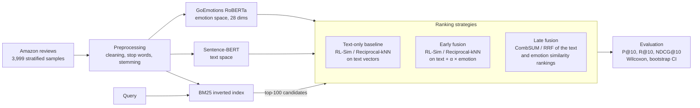
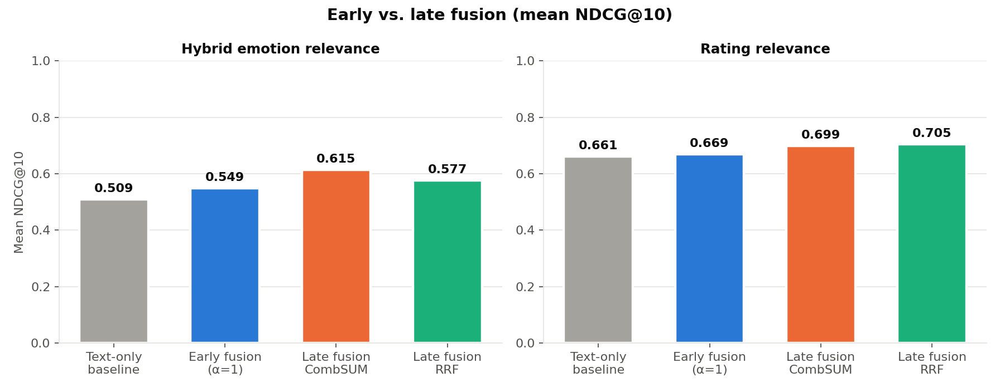
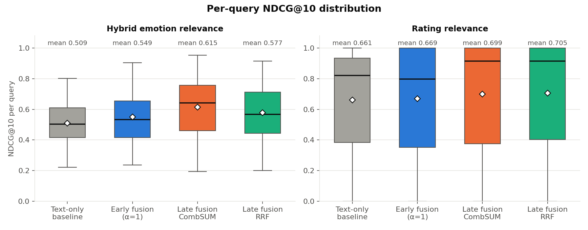
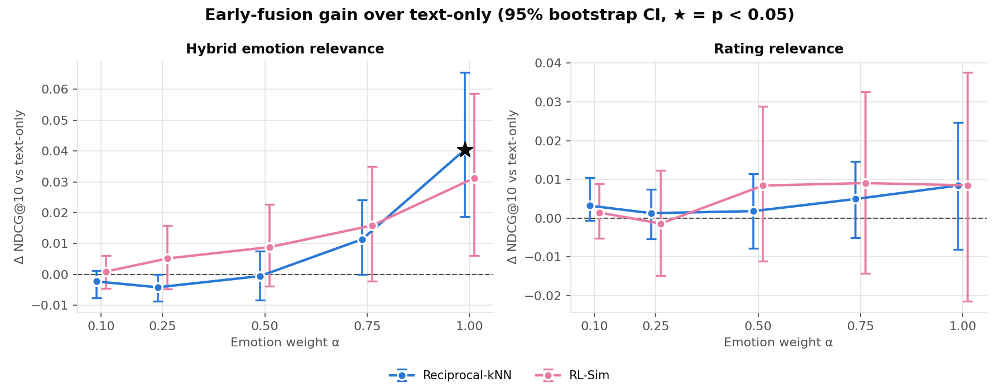
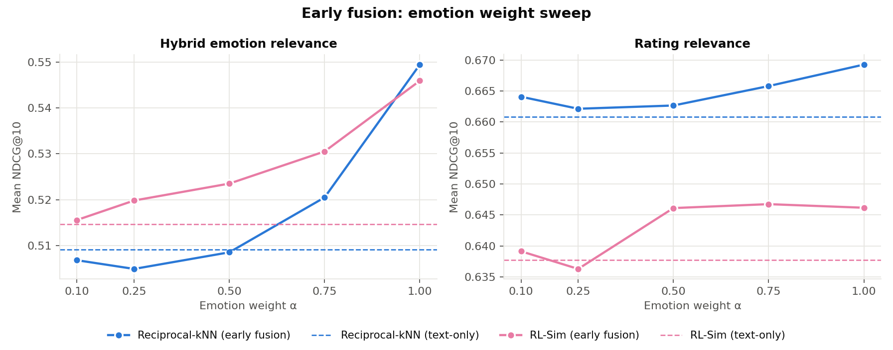

# Emotion-Aware Re-Ranking and Rank Fusion of Amazon Reviews

Final project for the **Information Retrieval** course (Computer Science, UNESP, 2026).

The project asks whether **emotions** improve the ranking of product reviews. Reviews are retrieved with BM25. The baseline then re-ranks them with two unsupervised methods, **RL-Sim** and **k-reciprocal nearest neighbours**, in a semantic space (Sentence-BERT). Emotion signals from a GoEmotions classifier (RoBERTa) are added in two ways:

- **Early fusion:** the text and emotion vectors are concatenated before re-ranking.
- **Late fusion:** the text-similarity and emotion-similarity rankings are merged with **CombSUM** or **Reciprocal Rank Fusion (RRF)**.

> **Main result:** late fusion was the best approach. It improved NDCG@10 by up to **+20.7 %** over the text-only baseline and **+11.9 %** over the best early-fusion setting, and it needs no tuning of a fusion weight.

---

## Table of contents

- [Pipeline](#pipeline)
- [Methodology](#methodology)
- [Results](#results)
- [Project structure](#project-structure)
- [Getting started](#getting-started)
- [References](#references)

---

## Pipeline



## Methodology

### Data

- **Dataset:** the [Amazon Reviews dataset](https://www.kaggle.com/datasets/dongrelaxman/amazon-reviews-dataset) from Kaggle, containing review text and a 1–5 star rating.
- **Sampling:** 3,999 reviews, stratified by star rating, with at least 150 per rating.
- **Preprocessing:** lowercasing, punctuation removal, scikit-learn English stop words plus the words *amazon* and *prime*, removal of tokens of 2 characters or fewer, and Porter stemming for BM25.

### Representations

| Space | Model | Dimensions |
|---|---|---|
| Text (semantic) | Sentence-BERT `all-MiniLM-L6-v2` | 384 |
| Emotion | GoEmotions classifier `SamLowe/roberta-base-go_emotions` | 28 (probability for each emotion) |

Both spaces are standardised (z-score) before they are combined.

### Retrieval and re-ranking

1. **BM25** (k1 = 1.5, b = 0.75) over an inverted index retrieves the top 100 candidates for each query.
2. The candidates are re-ranked by:
   - **RL-Sim**: replaces the pairwise similarity with the overlap of the items' top-k neighbour lists (k = 10, 2 iterations).
   - **Reciprocal-kNN**: computes a Jaccard distance over expanded k-reciprocal neighbour sets and blends it with the cosine distance (k = 15, λ = 0.3).
3. Three ranking strategies are compared:
   - **Text-only** (baseline): each re-ranker on the Sentence-BERT vectors only.
   - **Early fusion**: each re-ranker on the concatenated vectors `[text ; α · emotion]`, for α ∈ {0.1, 0.25, 0.5, 0.75, 1.0}.
   - **Late fusion**: no re-ranker. The candidates are ranked by cosine similarity to the query twice, once in the text space and once in the emotion space, and the two rankings are merged with **CombSUM** (sum of min-max-normalised scores) or **RRF** (Σ 1 / (60 + rank)).

### Queries

| Source | Count | Description |
|---|---|---|
| Synthetic | 16 | Hand-written queries, each annotated with its target emotions and valence |
| Data-driven | 84 | 3 per GoEmotions emotion, sampled from the reviews that score highest for that emotion. The source review is removed from that query's candidate list. |

### Relevance judgments

- **Hybrid emotion relevance** (graded, 0 to 1). It rewards detailed reviews that express the query's target emotions and penalises short, vague ones:

  ```
  relevance = 0.5 · max(target emotion scores) + 0.3 · informativeness + 0.2 · mentions an aspect
  informativeness = 0.4 · length (saturates at 50 words) + 0.4 · aspect density + 0.2 · lexical richness
  ```

- **Rating relevance** (binary): a review is relevant if its star rating matches the query's valence, meaning 4–5 stars for a positive query and 1–3 stars for a negative one. Queries for the *neutral* emotion have no valence, so they are left out of this evaluation (97 queries instead of 100).

### Evaluation

The metrics are Precision@10, Recall@10 and NDCG@10. Each early-fusion setting is compared with the text-only baseline using a one-sided **Wilcoxon signed-rank test** on per-query NDCG@10 and a **95 % paired bootstrap confidence interval** (2,000 resamples) of the mean difference.

## Results

### Hybrid emotion relevance (100 queries)

| Method | Algorithm | α | NDCG@10 | Δ vs text-only [95 % CI] | p-value |
|---|---|:-:|:-:|:-:|:-:|
| Text-only | RL-Sim | – | 0.515 | – | – |
| Text-only | Reciprocal-kNN | – | 0.509 | – | – |
| Early fusion | RL-Sim | 1.0 | 0.546 | +0.031 [+0.006, +0.059] | 0.060 |
| Early fusion | Reciprocal-kNN | 1.0 | 0.549 | +0.040 [+0.019, +0.066] | **0.013** ✔ |
| Late fusion | CombSUM | – | **0.615** | – | – |
| Late fusion | RRF | – | 0.577 | – | – |

### Rating relevance (97 queries)

| Method | Algorithm | α | NDCG@10 | Δ vs text-only [95 % CI] | p-value |
|---|---|:-:|:-:|:-:|:-:|
| Text-only | RL-Sim | – | 0.638 | – | – |
| Text-only | Reciprocal-kNN | – | 0.661 | – | – |
| Early fusion | RL-Sim | 1.0 | 0.646 | +0.008 [−0.021, +0.038] | 0.239 |
| Early fusion | Reciprocal-kNN | 1.0 | 0.669 | +0.008 [−0.008, +0.025] | 0.144 |
| Late fusion | CombSUM | – | 0.699 | – | – |
| Late fusion | RRF | – | **0.705** | – | – |

The early-fusion rows show α = 1.0. That is the best weight in every case except RL-Sim under rating relevance, where α = 0.75 scores slightly higher (0.647). The [figures](#figures) cover the full α sweep. The significance tests compare early fusion with the text-only baseline only; late fusion was not tested.

### Key findings

- **Late fusion beats early fusion in both evaluations, with no weight to tune.** Under emotion relevance, CombSUM reaches NDCG@10 = 0.615. That is **+11.9 %** over the best early fusion and **+20.7 %** over the text-only Reciprocal-kNN. Under rating relevance, RRF is best (0.705, +5.3 % over the best early fusion).
- **Early fusion is sensitive to α.** Small weights (α ≤ 0.5) give little or no gain; under emotion relevance, Reciprocal-kNN even loses some NDCG. The only statistically significant early-fusion gain is **Reciprocal-kNN with α = 1.0** under emotion relevance: +0.040 NDCG@10, p = 0.013, with a CI entirely above zero.
- **Under rating relevance, no early-fusion setting is significant.** Every confidence interval crosses zero.
- **CombSUM is more consistent from query to query.** Under emotion relevance it has the highest lower quartile, so hard queries fail less often. A plausible reason is that summing normalised scores keeps the intensity of the emotion signal, which is lost when only rank positions are combined (RRF).
- **By design, the hybrid relevance measure penalises only a lack of content, whatever the sentiment.** Detailed negative reviews therefore count as highly relevant, and those reviews are among the most useful for both shoppers and sellers.

### Figures









## Project structure

```
.
├── emotion_reranking/
│   ├── __main__.py            # CLI: `run` the experiment, `plot` figures from saved results
│   ├── config.py              # ExperimentConfig dataclass + domain constants
│   ├── pipeline.py            # ExperimentPipeline: orchestrates the whole experiment
│   ├── data/
│   │   ├── loader.py          # AmazonReviewsLoader: CSV / Kaggle download, stratified sampling
│   │   ├── preprocessing.py   # cleaning, tokenisation, stemming
│   │   └── queries.py         # Query, synthetic queries, DataDrivenQueryBuilder
│   ├── retrieval/bm25.py      # BM25 over an inverted index
│   ├── encoders/              # TextEncoder / EmotionEncoder interfaces + Sentence-BERT, GoEmotions
│   ├── reranking/             # Reranker interface + RL-Sim, k-reciprocal
│   ├── fusion/                # EarlyFusion, LateFusion interface + CombSUM, RRF
│   ├── relevance/             # RelevanceJudge interface + hybrid emotion, rating
│   ├── evaluation/            # P@k, R@k, NDCG@k, Wilcoxon + bootstrap CI
│   └── visualization/plots.py # result figures
├── tests/                     # unit tests + end-to-end smoke test (fake encoders, no downloads)
├── docs/figures/              # figures shown in this README
├── data/                      # place the dataset CSV here (not versioned)
└── requirements.txt
```

### Design

| Pattern | Where | Why |
|---|---|---|
| **Strategy** | `Reranker`, `LateFusion`, `RelevanceJudge` | Re-rankers, fusion methods and relevance definitions share one interface, so the pipeline loops over them and a new method needs no change to the pipeline |
| **Facade** | `ExperimentPipeline` | A single `run()` call hides retrieval, encoding, re-ranking, evaluation and reporting |
| **Dependency injection** | `ExperimentPipeline(..., emotion_encoder=, text_encoder=, rerankers=, ...)` | Any component can be swapped; the tests run the full pipeline with fake encoders |
| **Adapter** | `GoEmotionsEncoder`, `SentenceBertEncoder` | Wrap Hugging Face and sentence-transformers models behind the `EmotionEncoder` / `TextEncoder` protocols |
| **Factory** | `default_rerankers`, `default_late_fusers` | Build the configured components from an `ExperimentConfig` |
| **Configuration object** | `ExperimentConfig` (dataclass) | Every parameter of a run lives in one place |

The heavy dependencies (`torch`, `transformers`, `sentence-transformers`) are imported only when an encoder is created. Everything else, including the tests, runs without them.

## Getting started

### 1. Install

```bash
git clone https://github.com/t-tomiyama/Information-Retrieval-Project.git
cd Information-Retrieval-Project
python -m venv .venv
source .venv/bin/activate        # Windows: .venv\Scripts\activate
pip install -r requirements.txt
```

### 2. Get the dataset

The dataset is not included in this repository because it contains reviewer names and profile links. Download `Amazon_Reviews.csv` from [Kaggle](https://www.kaggle.com/datasets/dongrelaxman/amazon-reviews-dataset) and place it at `data/Amazon_Reviews.csv`. If no CSV is found in `data/`, the pipeline downloads it automatically with `kagglehub`, which may ask for Kaggle credentials.

### 3. Run the experiment

```bash
python -m emotion_reranking run
```

This writes the per-query metrics, the significance tests and the late-fusion summary as CSV files to `results/`, and the figures to `results/figures/`. The run downloads the two transformer models on first use; a GPU is used if one is available.

Options:

```bash
python -m emotion_reranking run --data path/to/reviews.csv --output my_results --queries synthetic --n-docs 2000
python -m emotion_reranking plot --results results      # regenerate figures from saved CSVs
```

The remaining parameters (BM25, re-rankers, α values, relevance weights) are set in [`emotion_reranking/config.py`](emotion_reranking/config.py) and can also be passed to `ExperimentConfig` from Python:

```python
from emotion_reranking import ExperimentConfig
from emotion_reranking.pipeline import ExperimentPipeline

results = ExperimentPipeline(ExperimentConfig(alpha_values=(0.5, 1.0, 2.0))).run()
print(results.significance)
```

### 4. Run the tests

```bash
python -m unittest discover -s tests -t .
```

## References

- BAEZA-YATES, R.; RIBEIRO-NETO, B. *Recuperação de informação: conceitos e tecnologia das máquinas de busca*. Porto Alegre: Bookman, 2013.
- PEDRONETTE, D. C. G.; TORRES, R. da S. Image re-ranking and rank aggregation based on similarity of ranked lists. *Pattern Recognition*, 2013.
- ZHONG, Z. et al. Re-ranking person re-identification with k-reciprocal encoding. *CVPR*, 2017.
- CORMACK, G. V. et al. Reciprocal rank fusion outperforms Condorcet and individual rank learning methods. *SIGIR*, 2009.
- VOGT, C. C.; COTTRELL, G. W. Fusion via a linear combination of scores. *Information Retrieval*, 1999.
- DEMSZKY, D. et al. GoEmotions: a dataset of fine-grained emotions. *ACL*, 2020.
- REIMERS, N.; GUREVYCH, I. Sentence-BERT: sentence embeddings using siamese BERT-networks. *EMNLP*, 2019.
- PEDRONETTE, D. C. G. *Re-ranqueamento e agregação de listas*. Course material, Information Retrieval, UNESP, 2026.
- LAXMAN, D. *Amazon Reviews Dataset*. Kaggle, 2024. Available at: <https://www.kaggle.com/datasets/dongrelaxman/amazon-reviews-dataset>.
